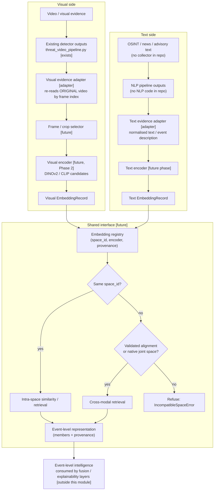
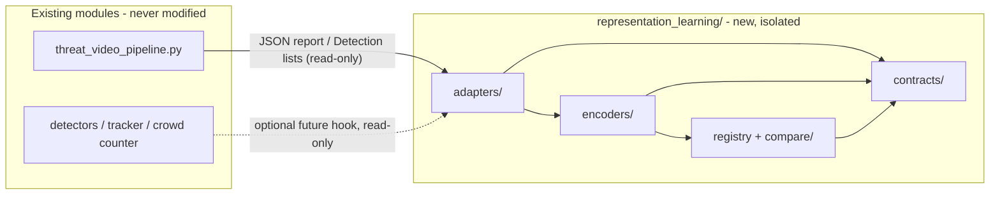

# Architecture (Phase 1 - proposed design)

Status legend: **[exists]** present in the repo at commit `f258199`;
**[adapter]** does not exist, must be written later as a thin adapter;
**[future]** new component in a later phase. Nothing marked [adapter] or
[future] is implemented.

## 1. Purpose and scope

See `../README.md`. This document defines the layered design, modality
boundaries, the comparison/alignment policy, error handling, privacy/security
considerations and the testing strategy for later phases.

## 2. Architecture diagram

Reading the diagram: the two sides never share a vector space by default.
The only path between modalities goes through the `Validated alignment or
native joint space?` gate.

### Component and dependency view

Dependency rule: `representation_learning` may read outputs of existing modules
through adapters; existing modules must never import from
`representation_learning`.

## 3. Layers and responsibilities

| Layer | Responsibility | Must not |
|---|---|---|
| Adapters | Convert upstream data (pipeline report, `Detection`, future Event Manager / NLP output) into the contracts in `data_contracts.md`. Only place that knows upstream formats. | Run detectors, mutate upstream data, call the network |
| Selector | Choose which frames/crops to encode (policy, sampling, quality filters). | Encode, or use annotated frames |
| Encoders | Map one validated input to one vector with full encoder metadata. One encoder = one `space_id`. | Share state across spaces, auto-download weights |
| Registry / store | Persist and look up `EmbeddingRecord`s; enforce metadata completeness. | Accept a record with missing provenance |
| Compare | Same-space similarity; cross-modal only through the gate in section 6. | Compare different `space_id`s without an alignment artifact |
| Event aggregation | Group member records into an event-level representation that keeps member ids. | Drop member provenance |

## 4. Modality boundaries

1. **Visual** inputs are pixels (frame or crop) plus the detector context that
   selected them. **Text** inputs are normalised text plus extraction context.
2. Neither modality is converted into the other inside this module. Detector
   labels (e.g. `pistol`) are stored as *metadata*, not as text to be encoded
   together with the image, unless a later phase explicitly defines a
   captioning/templating step and labels it as such.
3. Geospatial and temporal fields (location, timestamp) are metadata used for
   filtering and event grouping; they are not part of either embedding in
   Phase 1.
4. Each embedding belongs to exactly one `space_id` (encoder + weights hash +
   preprocessing + normalisation). Records from different spaces are never
   mixed in one index.

## 5. Interim upstream situation (honest constraints)

- **Annotated video must not be encoded.** `process_video` draws boxes and a
  banner onto the frame in place and writes the result to `*_analyzed.mp4`.
  Encoding that file would embed overlays. The adapter must re-read the
  original `input_video` at `frame` index.
- **Person detections are not in `threat_events`.** Only weapon/fire/smoke are
  listed per frame; persons appear only as `person_statistics`. Person crops
  therefore need a future read-only hook into detector output, not the report.
- **Track ids** exist only for persons in the pipeline report
  (`track_id: null` for weapon/fire). The standalone ByteTrack adapter is not
  wired into the pipeline.
- **Crowd count** is not produced by the pipeline; `CrowdCounter` is a
  standalone class over `List[Detection]`.
- **Configuration differs between entry points.** `threat_video_pipeline.py`
  runs weapon at `imgsz=320, conf=0.30`; `WeaponDetector` defaults are
  `imgsz=640, conf=0.40`. Provenance must record the effective settings
  (the report's `model_settings` already does for the pipeline).
- **Fire/smoke class map** is `0: Fire, 1: Smoke` in code and the pipeline;
  docstrings in `smoke_detector.py` state the opposite. Code was treated as
  authoritative; the docstring was not modified (flagged in the roadmap).
- **No event aggregation exists.** Until an Event Manager exists, "event" in
  this module means a *proposed grouping* made by this module's own adapter,
  clearly flagged as `event_source: "interim_grouping"`.
- **Text side:** no OSINT/NLP interface exists. `TextEvidenceItem` is a
  contract for a future adapter.

## 6. Comparison and alignment policy

Two vectors are comparable only if they live in the same space **and** that
space is meaningful for the comparison being made. Being numeric arrays of
equal length is not sufficient.

| Comparison | Allowed when | Notes |
|---|---|---|
| Visual vs visual | same `space_id` | Cosine/L2 per the encoder's declared metric. |
| Text vs text | same `space_id` | Same. |
| Visual vs text | (a) both produced by the two towers of one jointly trained image-text model (e.g. a CLIP checkpoint) **and** validated on this project's data, or (b) a learned alignment/projection artifact exists and passed validation | DINOv2 is image-only, so DINOv2 vectors have no text counterpart without (b). A text encoder chosen independently of the visual encoder has no shared space without (b). |
| Visual/text vs structured metadata | always allowed, but is *symbolic* matching (labels, place, time), not embedding comparison | Useful baseline and fallback. |

Alignment validation (required before enabling cross-modal retrieval; details
in `phase_roadmap.md`):

- a held-out set of paired (visual evidence, text) items with human-verified
  pairing - **none exists in the repo** and must be built or sourced;
- retrieval metrics (recall@k, median rank) in both directions;
- baselines: random, shuffled pairs, and the symbolic metadata matcher;
- check for the modality gap and class/domain bias (e.g. surveillance footage
  vs news photography);
- results stored as a versioned `AlignmentArtifact` referenced by every
  cross-modal query; absence of a passing artifact means the API refuses.

Any similarity score returned across modalities must carry the
`alignment_artifact_id` so consumers can see what justified it.

## 7. Error handling expectations

Follow the style already used by the repo's detectors (fixed, typed
exceptions; validate before inference; no silent fallbacks). Proposed
exception names (not implemented):

| Condition | Proposed error | Behaviour |
|---|---|---|
| Frame/crop not a 3-channel non-empty `ndarray`, or bbox out of bounds / zero area | `InvalidInputError` | Reject item; record reason; continue batch |
| Source video missing, unreadable, or frame index out of range | `EvidenceUnavailableError` | Skip item; never substitute another frame |
| Source video hash differs from recorded hash | `EvidenceIntegrityError` | Reject; flag for review |
| Encoder weights missing or SHA-256 mismatch | `EncoderIntegrityError` | Refuse to load (same pattern as existing detectors) |
| Output dim/dtype/NaN/Inf/zero-norm violates declared spec | `EmbeddingValidationError` | Discard vector; do not store |
| Compare across different `space_id` without alignment | `IncompatibleSpaceError` | Refuse; no best-effort result |
| Required provenance field missing | `ProvenanceError` | Refuse to store |
| Text empty after normalisation or beyond encoder limit | `InvalidInputError` / explicit `truncated=true` flag | Never truncate silently |

Batch jobs are best-effort per item, but every skipped item is reported in a
structured run summary; a run with zero valid items is an error, not success.

## 8. Privacy and security considerations

- **Personal data.** Person crops and frames may contain faces and other
  identifying features; OSINT text may contain names and locations. Embeddings
  derived from them are treated as personal data (they can enable re-identification
  or linkage). This module performs **no face recognition or identity matching**.
- **Minimisation.** Default is to store embeddings plus a *pointer*
  (video hash, frame index, bbox), not copies of crops. Persisting crops is an
  explicit, configurable opt-in with retention limits.
- **Access control.** Anything that returns evidence pointers or similarity
  results must sit behind the platform's authenticated API (FastAPI is in the
  diagram; it does not exist in the repo yet).
- **Model supply chain.** Reuse the repo's pattern: fixed local paths, SHA-256
  verification, no runtime-supplied URLs. Prefer weight formats that avoid
  arbitrary code execution on load; review licences of any encoder before use.
- **Secrets.** No API keys in code or docs. OSINT API credentials (e.g. NewsAPI)
  belong in environment variables; `.gitignore` already excludes `.env`.
- **Untrusted text.** OSINT text is untrusted input: length-limit it, strip
  markup, never execute or template it into code or shell.
- **Auditability.** Provenance (data_contracts.md section 4) must allow
  answering "which pixels/text produced this vector, with which model".
- **Bias and misuse.** Similarity results are leads for analysts, not
  determinations about people; documentation of encoders must note known
  domain-shift risk (CCTV, low light, small objects).

## 9. Testing strategy for later phases

Follows the repo's convention (per-module `pytest.ini`, `integration` marker for
real-model tests).

| Level | What | Phase |
|---|---|---|
| Contract tests | JSON Schemas in `data_contracts.md` validate good and bad examples; round-trip serialisation | 2 |
| Adapter tests | Fixture pipeline reports (a small sanitised copy of the existing `output/*_report.json` shape) map to `VisualEvidenceItem`; annotated-video input is rejected | 2 |
| Unit tests (mocked encoder) | Selector, validation, error paths, registry metadata enforcement | 2 |
| Determinism tests | Same input + same encoder -> same vector within tolerance; batch size does not change output beyond tolerance | 2 |
| Integration (`@pytest.mark.integration`) | Real encoder on `weapon_detection_project/fixtures/M1911_pistol.jpg`; dim, norm, dtype | 2 |
| Retrieval sanity | Nearest neighbour of a pistol crop is another pistol crop more often than chance, on a labelled subset | 2 |
| Encoder comparison | DINOv2 vs CLIP on identical crops, identical metrics, recorded in a report | 2 |
| Alignment validation | Section 6 protocol; required gate | 3+ |
| Regression | Pin `space_id` and a small golden-vector set; fail on silent encoder change | 2+ |
| Privacy tests | No crops persisted by default; no PII fields in logs | 2+ |

No test may require network access or download weights implicitly.

## 10. Explicit non-goals

- No implementation in Phase 1; no claim of runtime behaviour.
- No training/fine-tuning of existing detectors or replacement of them.
- No modification of any existing module.
- No assumption that Event Manager, OSINT, NLP, XAI, API or database modules exist.
- No threat scoring, classification or fusion inside this module.
- No face recognition / re-identification.
- No treating cross-modal similarity as valid without section 6 evidence.
