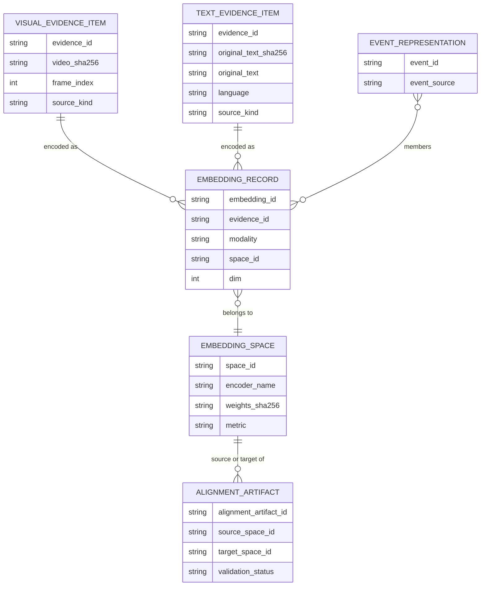

# Data contracts (Phase 1 - proposed, not implemented)

All schemas below are **proposals** for later phases. Field names that mirror
existing repo output are marked *(from repo)*; everything else is new.
Schemas use JSON Schema draft 2020-12. `schema_version` starts at `"0.1"`.

## 1. Entity overview



Consistency rule: `EMBEDDING_RECORD.evidence_id` refers to either a visual or a
text item according to `modality`; `space_id` must exist in `EMBEDDING_SPACE`.

## 2. Visual input contract: `VisualEvidenceItem`

### 2.1 What the existing pipeline provides

`threat_video_pipeline.py` writes `output/<video-stem>_report.json`. Relevant
keys *(from repo)*: `input_video`, `fps`, `resolution`, `frames_processed`,
`frame_skip`, `model_settings`, `threat_events[]`. Each `threat_events[]`
entry has `frame`, `timestamp_sec` (rounded to 2 decimals), `threats[]`, and
`detections[]` with `category`, `class_name`, `confidence`, `bbox`
(`[x1,y1,x2,y2]`, pixels), `track_id` (null except persons).

Limits to design around:

- Only `weapon`, `fire`, `smoke` detections are listed; **person detections and crowd counts are not in `threat_events`**.
- The report has no hash of the source video and no detector model hash (the hashes exist as constants/verification in code, not in the report).
- `output_video` is annotated; the contract refers to the **original** video only.
- Frames not run through inference (`frame_skip > 1`) reuse previous detections for drawing but add no events; the adapter must treat only inference frames as evidence.

### 2.2 Contract

| Field | Type | Req | Notes |
|---|---|---|---|
| `schema_version` | string | yes | `"0.1"` |
| `evidence_id` | string | yes | Deterministic: hash of (`video_sha256`, `frame_index`, `bbox`, `source_kind`) |
| `source_kind` | enum `frame` / `crop` | yes | `crop` requires `bbox` |
| `video_uri` | string | yes | Path to **original** video (not `*_analyzed.mp4`) |
| `video_sha256` | string | yes | Computed by adapter; not in current report |
| `frame_index` | int >= 0 | yes | Canonical position *(from repo: `frame`)* |
| `timestamp_sec` | number | yes | Derived `frame_index / fps`; report value is rounded, so recompute |
| `fps`, `resolution` | number, [w,h] | yes | *(from repo)* |
| `bbox_xyxy` | [4 numbers] | if crop | Pixel coordinates of the original frame *(from repo)* |
| `detector` | object | if crop | `category`, `class_name`, `confidence` *(from repo)*, `track_id` (nullable) *(from repo)*, `detector_name`, `model_sha256` (nullable), `settings` (`imgsz`,`conf`,`iou`) *(from repo `model_settings`)* |
| `report_uri` | string | no | Report the item was derived from |
| `location` | object | no | Optional `lat`,`lon`,`place_label`; supplied by a future GIS adapter, not by the pipeline |
| `sensitivity` | object | yes | `may_contain_persons` (bool), `retain_pixels` (bool, default false) |

### 2.3 JSON Schema

```json
{
  "$schema": "https://json-schema.org/draft/2020-12/schema",
  "$id": "visual_evidence_item.schema.json",
  "type": "object",
  "required": ["schema_version","evidence_id","source_kind","video_uri","video_sha256","frame_index","timestamp_sec","fps","resolution","sensitivity"],
  "additionalProperties": false,
  "properties": {
    "schema_version": {"const": "0.1"},
    "evidence_id": {"type": "string", "minLength": 8},
    "source_kind": {"enum": ["frame", "crop"]},
    "video_uri": {"type": "string", "not": {"pattern": "_analyzed\\.mp4$"}},
    "video_sha256": {"type": "string", "pattern": "^[0-9a-f]{64}$"},
    "frame_index": {"type": "integer", "minimum": 0},
    "timestamp_sec": {"type": "number", "minimum": 0},
    "fps": {"type": "number", "exclusiveMinimum": 0},
    "resolution": {"type": "array", "items": {"type": "integer", "minimum": 1}, "minItems": 2, "maxItems": 2},
    "bbox_xyxy": {"type": "array", "items": {"type": "number"}, "minItems": 4, "maxItems": 4},
    "detector": {
      "type": "object",
      "required": ["category", "class_name", "confidence", "detector_name", "settings"],
      "additionalProperties": false,
      "properties": {
        "category": {"enum": ["weapon", "fire", "smoke", "person"]},
        "class_name": {"type": "string"},
        "confidence": {"type": "number", "minimum": 0, "maximum": 1},
        "track_id": {"type": ["integer", "null"]},
        "detector_name": {"type": "string"},
        "model_sha256": {"type": ["string", "null"], "pattern": "^[0-9a-f]{64}$"},
        "settings": {
          "type": "object",
          "required": ["imgsz", "conf", "iou"],
          "properties": {"imgsz": {"type": "integer"}, "conf": {"type": "number"}, "iou": {"type": "number"}}
        }
      }
    },
    "report_uri": {"type": "string"},
    "location": {
      "type": "object",
      "properties": {"lat": {"type": "number"}, "lon": {"type": "number"}, "place_label": {"type": "string"}}
    },
    "sensitivity": {
      "type": "object",
      "required": ["may_contain_persons", "retain_pixels"],
      "properties": {"may_contain_persons": {"type": "boolean"}, "retain_pixels": {"type": "boolean"}}
    }
  },
  "allOf": [
    {"if": {"properties": {"source_kind": {"const": "crop"}}}, "then": {"required": ["bbox_xyxy", "detector"]}}
  ]
}
```

### 2.4 Example (illustrative values shaped after an existing report entry)

```json
{
  "schema_version": "0.1",
  "evidence_id": "ve_3f2a9c01d4",
  "source_kind": "crop",
  "video_uri": "input/example_clip.mp4",
  "video_sha256": "0000000000000000000000000000000000000000000000000000000000000000",
  "frame_index": 0,
  "timestamp_sec": 0.0,
  "fps": 30.0,
  "resolution": [1280, 720],
  "bbox_xyxy": [16.26, 99.52, 1274.38, 720.0],
  "detector": {
    "category": "weapon",
    "class_name": "rifle",
    "confidence": 0.579,
    "track_id": null,
    "detector_name": "WeaponDetector",
    "model_sha256": "66fdda89b7b535bd0afe50d61287b793d25fc7411338b6e14d2b8c9d48cd76f9",
    "settings": {"imgsz": 320, "conf": 0.3, "iou": 0.5}
  },
  "sensitivity": {"may_contain_persons": true, "retain_pixels": false}
}
```

The video hash is a placeholder; the model hash is the value already declared in
`threat_video_pipeline.py`.

## 3. Text input contract: `TextEvidenceItem`

No OSINT or NLP code exists in the repo, so this contract is the **target
interface of a future adapter**. Sources named in the README/diagram (GDELT,
NewsAPI, RSS, government/CERT advisories, weather alerts) are *candidates*, not
confirmed integrations.

| Field | Type | Req | Notes |
|---|---|---|---|
| `schema_version` | string | yes | `"0.1"` |
| `evidence_id` | string | yes | Deterministic from (`source_id`, `original_text_sha256`) |
| `source_kind` | enum `article` / `advisory` / `event_description` / `snippet` | yes | |
| `source` | object | yes | `source_name`, `source_url` (nullable), `source_item_id` (nullable), `retrieved_at` (UTC ISO-8601), `published_at` (nullable) |
| `original_text` | string | yes | Cleaned plain text in the **source language, never translated**; length-limited. Replaces `normalized_text`. |
| `original_text_sha256` | string | yes | Hash of `original_text`. Replaces `text_sha256`. |
| `language` | string | yes | BCP-47 tag of `original_text` |
| `translation` | object | no | Stored **separately**; never replaces `original_text`. Fields: `target_language`, `text`, `text_sha256`, `method`, `model_version` (all required when present). Replaces `original_language`, which is no longer needed because `language` now always describes `original_text`. |
| `truncated` | boolean | yes | Never truncate silently (applies to `original_text`) |
| `nlp_context` | object | no | Upstream extraction outputs (entities, event type, sentiment, keywords) with `nlp_model_version`; stored as metadata, not concatenated into the text unless a templating step is defined |
| `location` | object | no | `place_label`, optional `lat`,`lon` |
| `sensitivity` | object | yes | `may_contain_personal_data` (bool), `retain_text` (bool) |

```json
{
  "$schema": "https://json-schema.org/draft/2020-12/schema",
  "$id": "text_evidence_item.schema.json",
  "type": "object",
  "required": ["schema_version","evidence_id","source_kind","source","original_text","original_text_sha256","language","truncated","sensitivity"],
  "additionalProperties": false,
  "properties": {
    "schema_version": {"const": "0.1"},
    "evidence_id": {"type": "string", "minLength": 8},
    "source_kind": {"enum": ["article", "advisory", "event_description", "snippet"]},
    "source": {
      "type": "object",
      "required": ["source_name", "retrieved_at"],
      "properties": {
        "source_name": {"type": "string"},
        "source_url": {"type": ["string", "null"]},
        "source_item_id": {"type": ["string", "null"]},
        "retrieved_at": {"type": "string", "format": "date-time"},
        "published_at": {"type": ["string", "null"], "format": "date-time"}
      }
    },
    "original_text": {"type": "string", "minLength": 1, "maxLength": 20000},
    "original_text_sha256": {"type": "string", "pattern": "^[0-9a-f]{64}$"},
    "language": {"type": "string"},
    "translation": {
      "type": "object",
      "required": ["target_language", "text", "text_sha256", "method", "model_version"],
      "additionalProperties": false,
      "properties": {
        "target_language": {"type": "string"},
        "text": {"type": "string", "minLength": 1},
        "text_sha256": {"type": "string", "pattern": "^[0-9a-f]{64}$"},
        "method": {"type": "string"},
        "model_version": {"type": "string"}
      }
    },
    "truncated": {"type": "boolean"},
    "nlp_context": {"type": "object"},
    "location": {"type": "object", "properties": {"place_label": {"type": "string"}, "lat": {"type": "number"}, "lon": {"type": "number"}}},
    "sensitivity": {
      "type": "object",
      "required": ["may_contain_personal_data", "retain_text"],
      "properties": {"may_contain_personal_data": {"type": "boolean"}, "retain_text": {"type": "boolean"}}
    }
  }
}
```

**Multilingual policy.** `original_text` and `language` are always preserved. A translation, if
produced, goes in `translation` and never replaces or edits the original. No language-detection or
translation model is chosen or implemented.

## 4. Output contract: `EmbeddingRecord` (metadata and provenance for every representation)

A vector may be stored only with a complete record. The vector itself may live
in a separate store; the record holds a reference (`vector_ref`) and checks
(`dim`, `norm`).

| Group | Field | Req | Notes |
|---|---|---|---|
| Identity | `schema_version`, `embedding_id`, `evidence_id`, `modality` (`visual`/`text`) | yes | |
| Space | `space_id` | yes | Deterministic hash of encoder name + weights hash + preprocessing + pooling + normalisation |
| Vector | `dim`, `dtype`, `metric` (`cosine`/`l2`/`dot`), `normalized` (bool), `norm` (number), `vector_ref` | yes | `norm` ~1 if `normalized` |
| Encoder | `encoder.name`, `encoder.family`, `encoder.version_or_checkpoint`, `encoder.weights_sha256`, `encoder.license`, `encoder.source_ref` | yes | Weights hash mandatory (mirrors existing detector verification) |
| Preprocessing | `preprocessing` object (resize, crop, mean/std, colour order for visual; tokenizer, max length, language handling for text) | yes | Part of the space identity |
| Inference | `device`, `precision`, `framework_versions`, `batch_size` | yes | For reproducibility |
| Source provenance | `source_ref` -> the evidence item fields: video hash + frame index + bbox (visual); text hash + source id (text) | yes | Pointer, not pixels/text copy by default |
| Upstream provenance | `upstream.detector_model_sha256`, `upstream.detector_settings`, `upstream.nlp_model_version`, `upstream.report_uri` | if available | Null allowed only when upstream does not provide it |
| Lineage | `created_at` (UTC), `pipeline_version` (git commit of this module), `created_by_run_id` | yes | |
| Quality | `quality` object (`blur_score`, `crop_area_px`, `min_side_px`, `detector_confidence`; text: `char_count`, `truncated`) and `warnings[]` | yes | Warnings may be empty |
| Text variant | `text_variant` | no; **text records only** | Allowed values: `original_text`, `translation`. States which `TextEvidenceItem` field was embedded (`translation` is valid only if the item has a `translation`; checked by the future text adapter, not by this schema). **Must be absent on visual records** (the schema rejects it). If absent on a text record, the encoded field is unspecified and must not be assumed. |
| Alignment | `alignment_artifact_id` | only when produced via projection | Null for native-space vectors |
| Privacy | `sensitivity`, `retention_until` (nullable), `access_label` | yes | |

```json
{
  "$schema": "https://json-schema.org/draft/2020-12/schema",
  "$id": "embedding_record.schema.json",
  "type": "object",
  "required": ["schema_version","embedding_id","evidence_id","modality","space_id","dim","dtype","metric","normalized","norm","vector_ref","encoder","preprocessing","inference","source_ref","created_at","pipeline_version","quality","sensitivity"],
  "additionalProperties": false,
  "properties": {
    "schema_version": {"const": "0.1"},
    "embedding_id": {"type": "string"},
    "evidence_id": {"type": "string"},
    "modality": {"enum": ["visual", "text"]},
    "space_id": {"type": "string"},
    "dim": {"type": "integer", "minimum": 1},
    "dtype": {"enum": ["float32", "float16"]},
    "metric": {"enum": ["cosine", "l2", "dot"]},
    "normalized": {"type": "boolean"},
    "norm": {"type": "number", "minimum": 0},
    "vector_ref": {"type": "string"},
    "encoder": {
      "type": "object",
      "required": ["name", "family", "version_or_checkpoint", "weights_sha256", "license"],
      "properties": {
        "name": {"type": "string"},
        "family": {"type": "string"},
        "version_or_checkpoint": {"type": "string"},
        "weights_sha256": {"type": "string", "pattern": "^[0-9a-f]{64}$"},
        "license": {"type": "string"},
        "source_ref": {"type": "string"}
      }
    },
    "preprocessing": {"type": "object"},
    "inference": {
      "type": "object",
      "required": ["device", "precision", "framework_versions"],
      "properties": {"device": {"type": "string"}, "precision": {"type": "string"}, "framework_versions": {"type": "object"}, "batch_size": {"type": "integer"}}
    },
    "source_ref": {"type": "object"},
    "upstream": {
      "type": "object",
      "properties": {
        "detector_model_sha256": {"type": ["string", "null"]},
        "detector_settings": {"type": ["object", "null"]},
        "nlp_model_version": {"type": ["string", "null"]},
        "report_uri": {"type": ["string", "null"]}
      }
    },
    "created_at": {"type": "string", "format": "date-time"},
    "pipeline_version": {"type": "string"},
    "created_by_run_id": {"type": "string"},
    "quality": {"type": "object"},
    "warnings": {"type": "array", "items": {"type": "string"}},
    "alignment_artifact_id": {"type": ["string", "null"]},
    "text_variant": {"enum": ["original_text", "translation"]},
    "sensitivity": {"type": "object"},
    "retention_until": {"type": ["string", "null"]},
    "access_label": {"type": "string"}
  },
  "allOf": [
    {"if": {"properties": {"normalized": {"const": true}}}, "then": {"properties": {"norm": {"minimum": 0.99, "maximum": 1.01}}}},
    {"if": {"properties": {"modality": {"const": "visual"}}, "required": ["modality"]}, "then": {"properties": {"text_variant": false}}}
  ]
}
```

Illustrative example with placeholder encoder values (no encoder is chosen yet):

```json
{
  "schema_version": "0.1",
  "embedding_id": "emb_0001",
  "evidence_id": "ve_3f2a9c01d4",
  "modality": "visual",
  "space_id": "space_PLACEHOLDER",
  "dim": 768,
  "dtype": "float32",
  "metric": "cosine",
  "normalized": true,
  "norm": 1.0,
  "vector_ref": "store://placeholder/emb_0001",
  "encoder": {
    "name": "PLACEHOLDER_ENCODER",
    "family": "PLACEHOLDER",
    "version_or_checkpoint": "PLACEHOLDER",
    "weights_sha256": "0000000000000000000000000000000000000000000000000000000000000000",
    "license": "TO_BE_VERIFIED"
  },
  "preprocessing": {"resize": "TBD", "color_order": "RGB"},
  "inference": {"device": "cpu", "precision": "float32", "framework_versions": {"torch": "TBD"}, "batch_size": 1},
  "source_ref": {"evidence_id": "ve_3f2a9c01d4", "video_sha256": "0000000000000000000000000000000000000000000000000000000000000000", "frame_index": 0},
  "created_at": "2026-10-02T00:00:00Z",
  "pipeline_version": "TBD",
  "quality": {"min_side_px": 120},
  "warnings": [],
  "sensitivity": {"may_contain_persons": true, "retain_pixels": false},
  "access_label": "restricted"
}
```

`dim: 768` is a placeholder, not a decision.

## 5. Supporting contracts (summary)

- **`EmbeddingSpace`**: `space_id`, encoder block, preprocessing block, `metric`, `dim`, `modality`. Immutable once created.
- **`AlignmentArtifact`**: `alignment_artifact_id`, `source_space_id`, `target_space_id`, `method` (`native_joint_space` / `learned_projection` / ...), `training_data_ref`, `validation` (`status`: `unvalidated`/`passed`/`failed`; metrics; heldout-set hash; baselines), `created_at`. Cross-modal queries require `status == passed`.
- **`EventRepresentation`**: `event_id`, `event_source` (`event_manager` or `interim_grouping`), `member_embedding_ids[]`, `time_range`, optional `location`, `pooling_method`, `provenance_complete` (bool). Never stores a vector without its members.

## 6. Contract invariants (checked by future contract tests)

1. Every `EmbeddingRecord.space_id` exists in the space registry.
2. `modality` matches the evidence type behind `evidence_id`.
3. `visual` evidence never references an annotated (`_analyzed.mp4`) file.
4. A vector with `normalized: true` has norm within tolerance.
5. A record with `alignment_artifact_id` references an artifact with `status == passed`.
6. No record exists without `encoder.weights_sha256` and source pointer.
7. Event membership references existing embedding ids only.
