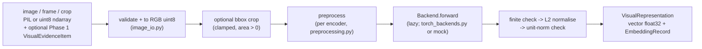

# Phase 2: visual encoder baseline (implemented; real-model validation PENDING)

## 0. Validation status

| Item | Status |
|---|---|
| Interface, validation, records, loaders, harness | Implemented |
| Unit tests with mocks and synthetic images | Done: pass |
| Real-loader code path with tiny *random* checkpoints | Done: pass (proves the code path, says nothing about model quality) |
| Existing-module regression | Done: identical to a pristine checkout (section 7) |
| Weights pinned in `models.manifest.json` | **PENDING** (owner downloads and records) |
| Real-checkpoint tests (`test_real_checkpoints.py`) | **PENDING** (8 tests currently skip) |
| Real-model smoke run on the committed video | **PENDING** |
| Representation-quality evaluation | **Not done / not possible yet** (no labelled set) |

Phase 2 is **not fully validated** until the three PENDING rows are executed. Commands:
`weights_and_models.md` section 2.

Scope: DINOv2 and CLIP **image** encoders behind one interface, with a smoke-test and
label-free measurement harness. No text encoder, no cross-modal alignment, no similarity
search, no clustering, no event grouping, no integration with the live video pipeline.

## 1. What was implemented



```text
representation_learning/
  encoders/    base.py (interface) dinov2.py clip.py torch_backends.py image_io.py
               preprocessing.py integrity.py manifest.py datatypes.py errors.py
  models.manifest.json   (pins: source, revision, licence, local path, SHA-256 - template, unpinned)
  evaluation/  inputs.py measure.py run_eval.py        (smoke test + label-free measurements)
  testing/     mocks.py tiny_checkpoints.py contracts.py (test support; NOT models)
  tests/       see section 7 for results
  requirements-phase2.txt  pytest.ini  .gitignore
```

Interface: `encoder.encode(image, *, color_order=None, evidence=None, bbox_xyxy=None,
input_is_crop=False) -> VisualRepresentation` and `encode_batch(...)`, which returns an
`EncodeFailure` per bad item (`on_error="collect"`) or raises (`"raise"`).
`VisualRepresentation.vector` is a read-only float32 array; `.record` is a Phase 1
`EmbeddingRecord` (validated against the schema parsed from `data_contracts.md`; there is
no second copy of the schema). `vector_ref` is only an in-memory placeholder: persistence
belongs to a later phase.

## 2. Model identifiers, feature and dimensions

| | DINOv2 | CLIP |
|---|---|---|
| Default checkpoint (initial CPU baseline; resource-based, **not a quality ranking**) | `facebook/dinov2-small` (ViT-S/14) | `openai/clip-vit-base-patch32` (ViT-B/32) |
| Other supported variants (configurable) | base 768-d (to evaluate later if hardware permits), large 1024-d, giant 1536-d | `vit-b-16` 512-d, `vit-l-14` 768-d (224 px only) |
| Extracted feature | CLS token of the last layer after the final LayerNorm (`Dinov2Model.pooler_output`); patch tokens unused | Projected image embedding (`CLIPVisionModelWithProjection.image_embeds`); text tower never used |
| Output dimension | **384** (small; base would be 768) | **512** (ViT-B/32) |
| Post-processing | L2 normalisation (float64 then cast to float32) | same |
| Loaded via | `transformers` `Dinov2Model`, local dir only | `transformers` `CLIPVisionModelWithProjection`, local dir only |
| Space | image-only, no text counterpart | trained jointly with a text tower, but **alignment is not validated on this project's data and Phase 2 makes no claim** |

Model sizes/dims above are from the published model configurations (not measured here).
The dimension is checked at load time against `config.json` and again on every output.

### Input scope and privacy (project decisions)

- **Target-object inputs are weapon/fire/smoke crops** with evidence provenance and bounding boxes (`source_kind: crop`).
- **Whole frames are refused** (`UnsupportedEvidenceError`) unless `diagnostic_only=True`; such records carry `quality.purpose = pipeline_diagnostic_only` and a warning, and the harness reports them in a separate section that feeds no other statistic.
- **Person evidence is refused**; there is no face recognition, identification or person tracking.
- **Pixels are never retained**: records hold hashes and pointers only, `sensitivity.retain_pixels` is forced to `false`, and evidence asking for `true` is refused (tests assert no pixel arrays/bytes in records).
- Ad-hoc images (no evidence item) are accepted for tooling convenience; the caller must supply target-object crops. The code cannot tell a crop from a frame in that case.
- The Phase 1 schema still permits `detector.category: person` (it describes pipeline outputs); the encoders enforce the exclusion.

## 3. Preprocessing

Both are implemented once in `preprocessing.py` (PIL + numpy, no torchvision) and are
cross-checked against the checkpoint's `preprocessor_config.json`: a mismatch refuses to
load (`EncoderIntegrityError`); a missing file only warns.

| Step | DINOv2 (`dinov2-imagenet-resize256-bicubic-centercrop224-v1`) | CLIP (`clip-resize224-bicubic-centercrop224-v1`) |
|---|---|---|
| Colour | RGB uint8 (explicit, see below) | same |
| Resize | shortest edge 256, bicubic, aspect kept | shortest edge 224, bicubic, aspect kept |
| Crop | centre 224x224 | centre 224x224 |
| Scale | /255 | /255 |
| Normalise | mean (0.485, 0.456, 0.406), std (0.229, 0.224, 0.225) | mean (0.48145466, 0.4578275, 0.40821073), std (0.26862954, 0.26130258, 0.27577711) |

Caveats: the centre crop discards image borders for non-square inputs (relevant to wide
frames); my resize is a PIL bicubic that may differ at the last-digit level from the
`transformers` processor, so embeddings should be compared only to others made by this
code. DINOv2 is run at 224 px with the model's interpolated position embeddings (the
standard Hugging Face recipe), not at its 518 px training resolution.

Channel handling: 3/4-channel ndarrays **must** declare `color_order` (`"BGR"` for OpenCV
frames, `"RGB"` otherwise) or are rejected; grayscale (2-D or 1-channel) is replicated to
RGB; RGBA/LA/palette-with-transparency is composited on white. PIL images are converted by
mode. Non-uint8 arrays, empty arrays, zero-area boxes, NaN boxes and sides > 16384 px are
rejected with `InvalidInputError`.

## 4. Error handling

`InvalidInputError`, `UnsupportedEvidenceError` (person category, annotated `*_analyzed.mp4`),
`EncoderLoadError` (missing/unreadable weights, unavailable device, torch missing),
`EncoderIntegrityError` (SHA-256 missing/mismatched, wrong model type/dim, preprocessing
disagreement), `EmbeddingValidationError` (wrong shape/dtype, NaN/Inf, zero norm, backend
exception), `IncompatibleSpaceError` (reserved for the later compare layer). Order of checks when loading: configuration and file/integrity checks (weights
directory, `config.json`, SHA-256, model type, dimension, preprocessing cross-check, precision) run
**before** the optional `torch`/`transformers` import, so an unconfigured or mismatched checkpoint
reports its real cause even where the real-model stack is not installed; the stack is demanded only
afterwards (`EncoderLoadError: torch and transformers are required ...`). Weights are
refused unless an expected SHA-256 is supplied (or `allow_unverified=True`, which records a
warning in the record).

## 5. Provenance recorded per embedding

Encoder name/family/checkpoint id (`<hf_id>@<revision>` when built from the manifest)/weights SHA-256/`config.json` SHA-256/licence (the pinned one)/source URL
and the exact feature extracted; full preprocessing spec; device, precision, torch and
transformers versions, batch size; source pointer (evidence id, video hash, frame index,
bbox, crop actually applied, source frame size) or, for ad-hoc images, the pixel hash; quality
hints (size, crop area, uncalibrated blur score, detector confidence if given); warnings;
sensitivity (`may_contain_persons` defaults to **true** for ad-hoc input; pixels are never
retained); pipeline version (module version plus git short hash when available); `space_id`
(hash of encoder, weights hash, feature, preprocessing, precision, normalisation).
Different encoders or weights therefore always have different `space_id`s.

## 6. Device and laziness

Nothing heavy is imported or loaded until first use (a test asserts `torch` is not imported
by importing the package or by mocks). `device="cpu"` is the default of the harness;
`"auto"` picks CUDA when available; an explicit `"cuda"` without CUDA fails with a clear error.
Only float32 is supported. CUDA was **not** available during Phase 2, so the CUDA path is
untested.

## 7. Tests, regression and boundaries

Run from the repo root: `python -m pytest representation_learning/tests -q`.

| Group | What it uses | Result |
|---|---|---|
| Unit tests (interface, validation, records, policy, manifest logic, harness) | mock backends, synthetic images, fake files; network blocked | pass |
| `tiny_random` tests | real loader + torch on tiny randomly initialised local checkpoints | pass |
| `real_checkpoint` tests | pinned real DINOv2-small / CLIP ViT-B/32 | **PENDING (skipped)** |

Existing-module regression (each module's own pytest, run in its directory): weapon 28, person 19,
crowd 8, ByteTrack 20, fire/smoke 15 passed + 2 failed. The two fire/smoke failures were
reproduced on a pristine `git worktree` checkout of HEAD `f258199`, which is also the current
remote HEAD, so they are pre-existing and not caused by this work. Cause: the two tests use class
id 0 as "smoke" while `fire_detector.py` defines `FIRE_CLASS_ID = 0`. Per decision, no detector
code or class mapping was changed.

No existing tracked file differs from HEAD; embeddings are not wired into
`threat_video_pipeline.py`; there is no function that compares two embeddings.

## 8. Known limitations

- **No real DINOv2/CLIP inference has been run.** Real latency, memory and embedding behaviour are unmeasured; tiny-random timings are not representative.
- Real adapters were verified against `transformers` 5.18.0 only, and the file layout of the Hub repositories (a single `model.safetensors`, a matching `preprocessor_config.json`) is assumed, not checked.
- The CPU wheel for the pinned PyTorch could not be verified from the sandbox (see `requirements-phase2.txt`).
- The smoke test covers one video; no labelled data exists, so no quality statement or ranking is possible.
- Centre-crop preprocessing, small low-resolution crops (the weapon detector ran at 320 px) and CCTV domain shift are unstudied.
- Crops taken from CCTV may still contain people; records default to `may_contain_persons: true`.

## 9. Remaining items before Phase 3

1. Owner downloads and pins the two checkpoints, then runs the real-checkpoint tests and the real smoke run (`weights_and_models.md`), and reports the output.
2. A labelled evaluation set is still needed for any quality claim (`evaluation_data_requirements.md`).
3. Approval of the Phase 2 contract amendments as shown in `phase1_contract_amendments.diff` (delivered with the Phase 2 report).
